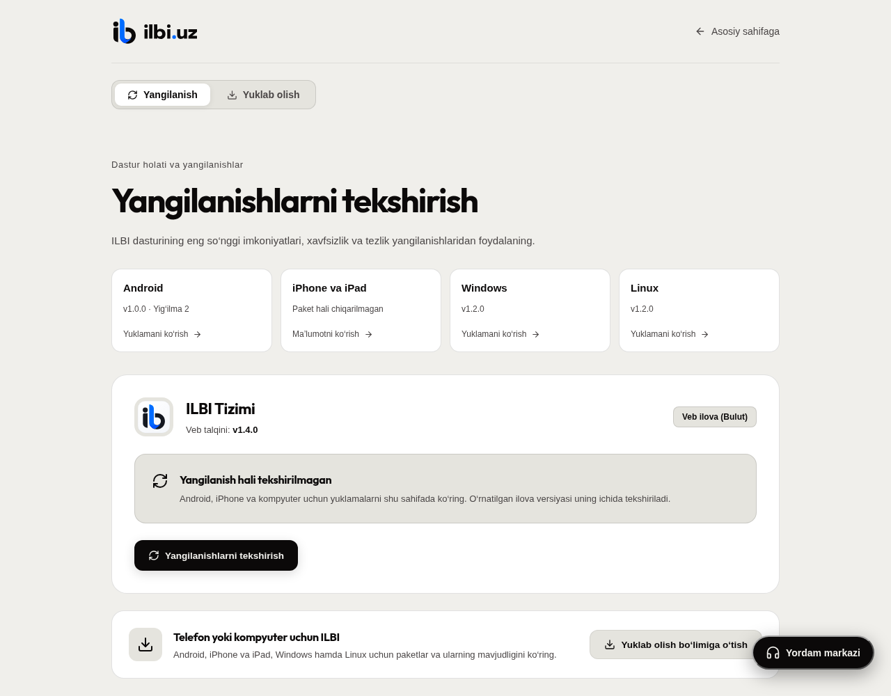
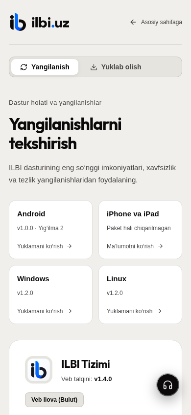

# Update/download entry validation — 2026-10-29

Owner requirement: opening the download screen should initially show **Yangilanish** on desktop and phone. Keep Android/iPhone downloads discoverable. Do not invent an unpublished iPhone package or report an installed-device test from a browser/component fixture.

## Native mobile source

- `DownloadsScreen` now defaults to Updates. An explicit `?tab=downloads` still selects Downloads. The Updates panel includes **Barcha ilovalarni ko‘rish**.
- Regression tests exercise the default selected tab, installed-version/candidate state, switching to actual Android release opening, unavailable iOS, and explicit Downloads deep links. The deep-link mock was corrected to target the router's actual Jest mock after the first full run caught the namespace-wrapper mismatch (728 passed, 1 failed).
- Final actual checks on the current main source: `npm run typecheck` passed; `node_modules/.bin/eslint . --max-warnings 0` passed; `npm test -- --silent`: **74 suites, 729 tests passed; no skipped tests**. Targeted updater suite: 6 passed. Logs: `/mnt/storage/.cache/ilbi-native-tools/download-default-2026-10-29/mobile-check-{0,1,2}.txt`.
- Existing concurrent back-navigation changes are preserved. Platform version remains 1.4.0 and mobile version 1.0.0.

## Acceptance limits

No new APK/IPA was built or published for this source change. The installed Android build 5 is unchanged, so its own download screen receives this change only with a future package. The owner's emulator was not queried, started, changed or reset. Native iPhone distribution and an installed-device test remain open; paid Apple membership is not yet available. This slice does not close the rest of the parity plan.

## Public web and desktop-renderer source

- `/download` opens Updates for anonymous and signed-in users on desktop and phone. Explicit Downloads query links and the old Linux installation anchor remain usable. All four platform shortcuts are visible immediately; mobile cards come before desktop cards at phone widths.
- Published Android feed metadata supplies the real APK link. An absent iOS release stays explicitly unavailable, with a separate browser-version link. No `.ipa`, App Store publication or home-screen/offline capability was invented.
- Unchecked status no longer claims the installed app/security is current. Browser checking refreshes the catalogue and explains that installed native versions must be checked inside their apps. Native desktop status continues through the actual bridge; applying updates retains its existing main-window restrictions.
- Actual web checks passed: **96 Node tests**, `npm run test:downloads` (real Chrome, fixture release/auth responses), `npm run build`, `npm run test:desktop-guide` (built offline guide), `node tests/updates.browser.mjs`, touched-file Oxlint, desktop installed-test syntax, and `git diff --check`. No browser scenario skipped. Initial tests reproduced the anonymous-default failure; a later test navigation retained its explicit Downloads query and was corrected to use fresh `/download` entry before the final passes.
- Final downloads suite was rerun after screenshot viewport corrections and passed. Logs: `/mnt/storage/.cache/ilbi-native-tools/download-default-2026-10-29/web-check-{0,1,2,3,4,5}.txt`, `web-downloads-final.txt`. Screenshots below use synthetic release versions/builds and are not production-feed or installed-iPhone evidence.

The installed Windows/Linux acceptance script now asserts the public default Updates tab before switching to its existing download/retry/setup checks. Those actual OS checks and automatic production deployment are pending the new main CI run at commit time; local browser/component results above do not substitute for them. Post-deploy evidence is recorded externally after CI finishes to avoid creating a deployment loop.

## iPhone distribution decision

The owner asked whether an IPA can be published for every customer without Apple membership. A file download does not authorize iOS installation. Apple's [developer account overview](https://developer.apple.com/help/account/basics/about-your-developer-account) limits free Personal Team testing to three devices with seven-day provisioning; [registered-device distribution](https://developer.apple.com/documentation/xcode/distributing-your-app-to-registered-devices) requires signing/provisioning for the specified devices. Paid membership and an agreed distribution method remain external gates. No account purchase, credential submission, unsigned public package or device enrollment was performed.
